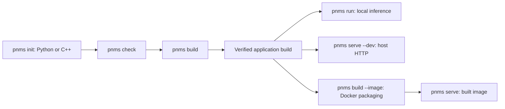

# PhysicsNeMo Serve application CLI

`pnms` provides one application workflow for Python plugins and compiled C++
workflows: initialize, check, build, run and serve. It composes the existing
Model Builder and serving code. Existing `plugin_dev.py`, `pnms-model-builder`
and C++ SDK commands retain their existing flags, defaults and formats.

The user workflow runs on your own machine or GPU cluster allocation. It does
not require Lepton. Our GPU acceptance and release QA use Lepton separately.

## Install from a source checkout

From the repository root, with Python 3.11 or newer:

```bash
python3 -m venv .venv
source .venv/bin/activate
python -m pip install -e ./application-cli
export PNMS_REPOSITORY="$PWD"
pnms --help
```

Keep the checkout available: the frontend locates the existing developer tools,
Model Builder and C++ sources there. Set `PNMS_REPOSITORY` when using the installed
command from another directory. Alternatively, invoke the checkout directly:

```bash
python "$PNMS_REPOSITORY/pnms" --help
```

All commands produce JSON reports. Errors go to stderr; failed checks and runs
return a nonzero exit code. Use `pnms COMMAND --help` for that command's options.
Custom `--output` directories for `run` and `serve` must be outside the selected
build's sealed bundle or frozen Python plugin.
For native host serving, this also applies to `serve.artifact_root`.

## Python plugin development

Initialize and exercise a CPU Python example:

```bash
pnms init my-plugin --runtime python
cd my-plugin
printf '{"value": 7}\n' > examples/request.json
pnms check
pnms run --dev --input examples/request.json
pnms build
pnms run --input examples/request.json
```

The example returns `value: 7` and `doubled: 14`. Initialization creates the
existing `plugin.yaml`, `workflow.py`, `examples/` and plugin README. A Python
project does not need `pnms.yaml`. The default profile is `python-test` and the
default pipeline is `simple`; use `--pipeline postprocess`, `batch`, `ensemble`
or `prefetch` when initializing a different pipeline.

Existing plugins need no initialization or migration:

```bash
cd /path/to/existing-plugin
pnms check --config-only
pnms build
pnms run --input examples/request.json
```

`build` captures the plugin source and assets under a new `.pnms/builds/`
directory. Normal `run` uses the last successful snapshot and its recorded
Python interpreter. `run --dev` reads current source and does not require or
publish a build. Restart development execution after editing source; hot reload
is not provided.

Python snapshots exclude `.env` and `.env.*` files and directories at every
level, including case variants and Git-ignored paths. Supply credentials through
the runtime environment. Image serving forwards only explicitly selected exports:

```bash
export NGC_API_KEY
pnms serve --env NGC_API_KEY
```

Repeat `--env NAME` for each exported variable the application needs. Pass names
only; `NAME=value` assignments are rejected. Local Python `check`, `run`, and
`serve --dev` already inherit exported variables; `--env` is image-serving-only
and cannot be combined with `--dev`. Development commands retain the current
source files.
Existing snapshots containing dotenv paths must be rebuilt before use or image
packaging, including `--from-build`.

Custom runtime profiles and phase executors already declared in a plugin stay
authoritative. Advanced scaffolding options remain available through the
unchanged [plugin development CLI](../scripts/plugin_dev.py).

Use a specific existing venv by adding this optional application descriptor, or
by passing `--python /path/to/venv/bin/python` to `check` or `build`:

```yaml
schema_version: 1
name: my-plugin
runtime: python
plugin: .
build:
  python: /path/to/venv/bin/python
```

Install the plugin's own dependencies into that environment. Python builds do
not compile native models, probe CUDA or require Docker. The first successful
build also generates `pnms.lock` for the selected interpreter and installed
distribution metadata; see [environment locking](#environment-lock-and-repeat-builds).

### Python checks and local HTTP development

```bash
pnms check --config-only
pnms check --through-phase prepare
pnms run --dev --input examples/request.json
pnms serve --dev --port 8080
```

`check` reuses plugin validation, readiness and supported example hooks. Its
`coverage` records which hooks ran and which service stages were not exercised.
`needs_setup` with a preparation-only result is a partial check, not a full
successful run; the new CLI returns nonzero while the legacy command keeps its
existing exit behavior.

Direct execution supports ordinary Python hooks. Fanout, nonempty prefetch
plans, enabled batching, publication stages and postprocess result operations
require the service pipeline and produce an actionable error. A prepare-only
check can still inspect those plans.

`serve --dev` uses the existing local server/worker topology and source checks.
It needs Redis, Rust service binaries or Cargo, and the existing Python worker
bindings. Follow the [plugin authoring guide](../docs/plugin-authoring-guide.md)
for those one-time prerequisites; the unchanged `plugin_dev.py bootstrap-python`
command can prepare its existing bindings. `--skip-build` uses already-built
service binaries. Development HTTP serving does not need a release image or
Docker.

## Native build and inference on a GPU node

Use Linux x86_64 with a compatible NVIDIA driver, CUDA development toolkit
including `nvcc`, CMake and a C++20 compiler. A Python venv supplies Python
dependencies; it does not install the driver or native compiler toolchain.
Select the GPU assigned to you by the cluster scheduler. If the scheduler has
already set `CUDA_VISIBLE_DEVICES`, retain that allocation.

For an existing venv, install compatible model/export dependencies from the
repository root, then initialize and build the included affine example:

```bash
python -m pip install './native-inference/model-builder[export]'
pnms init my-native --runtime cpp --backend aoti
cd my-native
pnms check --config-only
pnms build --environment local
pnms run --input examples/request.json
```

The generated model computes `values * 2 + 1`. Its two independent workflow
fixtures and model self-test fixtures are included. For the default input
`[0, 1, -1, 4]`, the result is `[1, 3, -1, 9]`.

`pnms` prepares or reuses a compatible installed inference SDK, delegates model
compilation and numerical checks to Model Builder, builds or
reuses the shared workflow host, and verifies the application fixtures. Local build and
direct inference require neither Docker nor Rust/Redis.

Existing tensor/custom native plugins retain their authored pipeline and may use
a custom schedule queue. The native worker requires the terminal results stage
to keep both id and queue `results`, with `next: null`. Schedule queues cannot use
the internal streams `release`, `results`, or `dlq`, or end in the reserved
consumer-group suffix `:grp`. `pnms` rejects unsupported pipelines before
compilation and leaves the authored files and last successful build intact.

If several allocated GPUs are visible, select one at build time:

```bash
pnms build --environment local --gpu 0
```

The numeric selector is a logical index within the current allocation. The
build records the selected GPU product/architecture and runtime stack; a
different GPU or incompatible runtime stack does not reuse an unrelated cached
compiled model. Runtime admission checks the actual serving device.

### Existing or managed environments

This minimal native descriptor is generated by initialization:

```yaml
schema_version: 1
name: my-native
runtime: cpp
models:
  primary:
    project: model/model-build.json
build:
  backend: aoti
  environment: local
  target: current-gpu
workflow:
  template: tensor
serve:
  port: 8080
```

For an existing environment, optional `build.python`, `build.runtime` and
`build.sdk_prefix` select its Python interpreter, `physicsnemo-infer` executable
and complete installed C++ SDK. An executable alone does not supply the SDK's
headers, libraries and CMake package.

Alternatively, add `venv: .pnms/env` under `build`. `pnms` delegates creation of
that managed environment to the existing Model Builder setup command and
prepares the installed SDK. Optional `build.requirements` is a list of existing
requirements files relative to the application root. There is no need to run a
separate Model Builder command in the normal application workflow.

For TensorRT, initialize with `--backend tensorrt`, install compatible TensorRT
Python/export dependencies, and supply the full TensorRT C++ SDK through
`build.tensorrt_root`. A pip package alone does not replace the native SDK.
`build.tensorrt_cuda_major` selects the SDK CUDA major when creating a managed
environment. See the [Model Builder setup guide](../native-inference/docs/user-guide.md).

### Your model and custom C++ workflow

To adopt an existing Model Builder project:

```bash
pnms init my-serving-app --runtime cpp \
  --model-project /path/to/model/model-build.json
```

The application references the project; it does not rewrite the original
project or its lock. Replace the generated affine request, workflow cases and
model self-tests with independent expectations for your own model before
building. Update its model adapter, weights and representative tensor cases as
described in the [Model Builder guide](../native-inference/docs/user-guide.md).

The tensor template maps JSON fields to compiled tensors without user C++.
For custom preprocessing/postprocessing, use:

```bash
pnms init custom-native --runtime cpp --template custom --backend aoti
```

This also creates `native/workflow.cpp` and `native/CMakeLists.txt`. Edit the
generated workflow implementation, which calls `context.infer("primary", ...)`,
then run the same `check`, `build` and `run` commands. C++ source changes require
a build before execution.

### Raw tensor file inputs

The tensor workflow also accepts little-endian FP32 files. For the generated
four-element affine model, set these fields in `pnms.yaml`:

```yaml
workflow:
  template: tensor
  tensor_adapter:
    model_alias: primary
    inputs:
      input: {request_field: values, codec: raw-fp32-le}
    outputs:
      output: {response_field: values, codec: json-array-fp32}
ingress:
  content_type: multipart/form-data
  files:
    - name: features
      required: true
      media_types: [application/octet-stream]
      max_size_mb: 1
```

Use the following `request.json`, with shape and byte size matching your tensor:

```json
{"values":{"artifact":"features","dtype":"float32","shape":[4],"byte_order":"little","layout":"contiguous","size_bytes":16}}
```

Each independent case in `fixtures/cases.json` uses the same request descriptor
and an `inputs` mapping such as `{"features":"fixtures/input.f32"}`, alongside
its expected output. Build captures those fixture bytes inside the sealed bundle;
fixture paths are relative to the application root. Declared file limits and
media types apply to fixture checks and inference.

```bash
pnms build my-app
pnms run my-app --input request.json --input-file features=input.f32
pnms serve my-app --dev
```

For HTTP, send the descriptor as the `values` form field and upload its file:

```bash
curl -F 'values={"artifact":"features","dtype":"float32","shape":[4],"byte_order":"little","layout":"contiguous","size_bytes":16}' \
  -F 'features=@input.f32;type=application/octet-stream' \
  http://127.0.0.1:8080/v1/infer/my-app/run
```

### Build outputs and direct SDK use

A successful native build's JSON report includes:

- `models.<alias>.package`: the complete compiled model package for existing C++
  SDK consumers, with `model.json` and the selected backend's artifacts;
- `bundle`: the relocatable application containing the same model bytes and
  compiled shared workflow;
- `bundle_digest`, environment identity, validation evidence and stage results;
- `environment_lock.digest` and `environment_lock.snapshot`: the generated
  application stack lock identity and its complete snapshot for this build.

Those paths are relative to the report's `root`. AOTI packages contain
`model.pt2`; TensorRT packages contain `model.plan`. Keep each complete package,
including its manifest and dependencies. There is no separate model-only build
target or extraction step. The existing [C++ SDK](../native-inference/cpp-runtime/README.md)
can consume the compiled model package directly.

The shared workflow and direct runner are installed under
`bundle/workflow/lib/` and `bundle/workflow/bin/`. `pnms run` resolves the bundle
automatically; it does not copy model artifacts by hand or need a service stack.

### Environment lock and repeat builds

The native build probes the selected Python interpreter, including a venv
chosen with `--python` or `build.python`. Its receipt records the installed
distribution versions, relevant Torch/TensorRT file fingerprints, native
compiler/SDK/runtime identity, linked provider library hashes and selected GPU
product/architecture. Replacing relevant dependency bytes can invalidate reuse
even when the advertised package version is unchanged. A venv does not isolate
the GPU driver, CUDA toolkit or system libraries; those must also be compatible.

The first successful `pnms build` creates `pnms.lock` in the application root.
Each build receipt retains its lock digest and complete snapshot, so later lock
refreshes do not rewrite earlier receipts. Initialization and checks do not
create the application lock. You can commit the generated lock with your
application source.

Subsequent builds compare the selected environment with this lock. Native locks
record backend, C++ ABI, dependency/provider fingerprints, SDK/runtime bytes,
toolchain versions and GPU product, SM architecture, MIG mode and driver.
Explicit container builds also record the pinned outer `build.builder_image`
reference, even though Builder runs in local mode inside that image. Installation
paths and GPU UUIDs are excluded. Model source, weights, custom workflow source,
fixtures and HTTP contracts are excluded, so ordinary application edits do not
require a lock refresh when the selected environment stays the same.

For Python plugins, the lock records only the selected interpreter's version,
implementation/platform and distribution versions/metadata identities. This
works with the existing `--python` or `build.python` venv selection and adds no
Torch, CUDA, GPU, native SDK or Docker requirement.

On drift, the diagnostic identifies differing fields, such as `native.gpu.name`
when selecting another GPU product, and asks you to restore the locked
environment or explicitly accept the new stack:

```bash
pnms build --refresh-lock
# Optional: pnms build --refresh-lock --image my-application:0.2
```

Observed dependency/GPU drift is rejected before SDK creation; the complete
installed SDK/provider identity is checked before model compilation. Refresh
replaces the lock only after the complete requested build, fixture checks and
optional image packaging succeed. A failed refresh preserves the prior lock,
last successful build and last successful image selection. Concurrent publication
is serialized so a stale failed attempt cannot roll back a completed build.
`--from-build` consumes its completed receipt without refreshing the lock and
cannot be combined with `--refresh-lock`.

This is a generated **observed environment lock**, not a dependency installer or
a complete reproducible-environment specification. It does not install a locked
Python environment or hash every arbitrary package file. Existing Model Builder
locks remain independent and authoritative for their own projects; application
builds use captured copies without rewriting the original model project or lock.

### Independent native compilation caches

Prepared SDK installations, verified model outputs and compiled C++ workflows
have separate caches. An unchanged workflow can be reused when model weights or
HTTP settings change. Workflow entries live under the application's
`.pnms/cache/workflows/<identity>/`; no additional command is needed. The build
report records `workflow.identity`, `workflow.reused` and its cache seal path.

SDK cache lookups first configure CMake and fingerprint the package configuration,
include trees and link inputs it actually selected. A verified hit reuses the
installed SDK and skips compilation and installation. SDK reuse also checks
source and compiler bytes, compiler settings, and supported forced headers and
response files. Builds using custom CMake toolchain files,
configured compiler header search paths, or unrecognized compiler options
create a fresh SDK installation. Known inputs are checked again after
compilation so an edit during the build cannot publish an SDK under an earlier
input identity. Missing dependency metadata also forces a fresh SDK build.

Workflow identity includes the workflow/runtime and SDK source bytes, installed
SDK inventory, backend, selected provider/ABI identity, compiler bytes and
version, compile environment, and custom source and declared dependencies.
Every build configures CMake to discover the actual compile options, package
configuration, explicit and implicit include trees, and external link libraries.
Their contents participate in the identity, including static archives and
headers reached through system symlinks. A changed header or library can
invalidate reuse even if its path and version stay the same. Model weights,
HTTP code/settings and per-attempt output paths are excluded from this workflow
identity; keep model assets outside the native source/dependency trees.

List additional files or directories used by custom build recipes under
`workflow.dependencies`, relative to the application root:

```yaml
workflow:
  template: custom
  source_dir: native
  target: my_workflow
  dependencies:
    - shared/include
    - codegen/schema.json
```

On a hit, `pnms` verifies the exact sealed installation inventory, copies it into
the new build attempt, and captures compatibility against the selected runtime
again. CMake configuration and compatibility checks still run; compilation and
installation are skipped. Configure-time fetched headers remain inputs, while
outputs first generated during compilation are sealed as artifacts. Relevant
inputs are checked again before a new cache entry is published.

New entries are published atomically from private staging directories, and
concurrent publishers cannot expose a partial entry. Corrupt or incomplete
entries fail with the affected cache path; remove that entry and rebuild.
Every application build still assembles a new bundle and runs its fixtures.
Normal `run` and `serve` consume completed outputs and do not compile models.
The repository's [acceptance workflow](../qa/native_inference/PNMS.md) checks
model and workflow reuse separately; CPU cache checks do not replace GPU QA.

## Optional native container compilation

Set `build.builder_image` to your immutable compiler/SDK image reference, such
as `your-registry/compiler@sha256:<64-hex-digest>`. It must contain the selected
framework, model dependencies, compatible native toolchain/SDK and application
CLI Python dependencies.

```bash
pnms build --environment container
pnms run --input examples/request.json
```

The outer container sees only the selected allocated GPU. `pnms` invokes the
Builder in local mode inside it, then captures the workflow and
models together. Subsequent direct execution follows the recorded container
environment. Docker is required for this explicitly selected path. Local mode
does not silently fall back to Docker.

Python source packaging uses its local venv. Use `--image` for Python Docker
release packaging; `--environment container` selects native compilation only.

## HTTP serving and release images

For native host HTTP development after a successful local build:

```bash
pnms serve --dev --port 8080
```

This prepares disposable workspace configuration and starts owned Redis,
scheduler, results, native worker and HTTP server processes. It uses the
compiled bundle, exposes native readiness, and cleans up its own processes on
shutdown. First-time host serving needs Cargo and Redis; it does not need
Docker. CPU-only image assembly and GPU compilation are separate stages.

Creating a release image requires Docker/BuildKit. Add a pinned `serve.image`
reference to `pnms.yaml` before packaging:

```yaml
serve:
  port: 8080
  image: your-registry/runtime@sha256:<64-hex-digest>
```

For native workflows, choose a runtime image matching the selected Python,
Torch/CUDA or TensorRT stack and C++ ABI. Packaging checks compatibility and
fails on a mismatch; it does not silently recompile the model for another
stack. For Python plugins, the base must be a complete existing PhysicsNeMo
Serve Python server/worker image, with its entrypoint, binaries and the plugin's
dependencies. An arbitrary CUDA or PyTorch base is insufficient.

```bash
pnms build --image my-application:0.1
pnms serve --port 8080
```

For Python and native images, add repeatable `--env NAME` selections to forward
exported host variables. Unselected host variables are not forwarded. Names must
be portable environment identifiers, and missing exports fail before launch;
exported empty values are allowed. Duplicate names are forwarded once, in the
selected order. The launcher reserves its identity, GPU, port, topology, and
runtime path settings, including the `PNMS_`, `NATIVE_`, and
`PHYSICSNEMO_SERVE_` namespaces. Docker inherits each selected value from the host;
PNMS records only its name in command arguments and `launch.json`. Docker's
container environment and application output may still contain the value.

The image includes the compiled models and shared C++ workflow for a native
application. They reside under `/opt/physicsnemo-release/models/` and
`/opt/physicsnemo-release/workflow/`. Python images retain their Python source
and runtime through the existing serving image. `serve` selects the immutable
local image ID rather than relying on a mutable tag. Publishing is explicit:

```bash
pnms build --image your-registry/my-application:0.1 --push
```

An existing completed build can be packaged on a separate Docker host with
access to the complete build directory:

```bash
pnms build --from-build /shared/application-build/build.json \
  --image my-application:0.1
```

Packaging verifies that the checkout revision matches the build receipt and
that its tracked packaging inputs are unchanged, then freezes those files in a
private Docker context. Use the exact clean source revision when packaging an
older build with `--from-build`. Untracked workspace files are excluded.
Native images compile the server from that verified source. Python images
verify and copy the release helper; their server remains supplied by the pinned
`serve.image` base.

For a Git-less source export, set `PNMS_SOURCE_METADATA=/path/to/source.json`.
Supply the original trusted clean-source capture receipt and its adjacent
`source-inventory.json`, as produced by `scripts/prepare_pnms_qa_context.py`.
The receipt must contain the matching `source_sha`, `source_dirty: false`, and
`source_inventory_sha256`. Packaging verifies the inventory digest and each
copied file's SHA256, size and file mode where supported. `PNMS_SOURCE_SHA` alone
cannot verify an exported source tree.

The CLI passes the sealed compiled bundle into image assembly automatically;
there is no manual model-to-image copy step. No GPU is needed for image assembly.
Packaging records GPU startup/HTTP checks as not run; successful image assembly
does not by itself qualify a release.

Repository QA exercises this same public packaging command and qualifies the
published immutable image separately. These tests belong to our CI infrastructure;
they do not add cloud tools or accounts to the application commands. See the
[QA profile guide](../qa/native_inference/PNMS.md) for the tested paths.

Repository automation also connects GPU compilation, verified build handoff,
CPU image packaging, and immutable-image Lepton acceptance for AOTI and
TensorRT. The [automatic release qualification guide](../qa/native_inference/PNMS.md#automatic-native-release-qualification)
describes its approval policy and CI configuration. This automation uses the
same public build and packaging commands shown above.

The HTTP API keeps its existing asynchronous contract. For the native example:

```bash
curl --fail-with-body http://127.0.0.1:8080/readyz
curl --fail-with-body http://127.0.0.1:8080/v1/infer/my-native/run \
  -H 'Content-Type: application/json' \
  -d '{"parameters":{"values":[0,1,-1,4]}}'
# Poll /v1/infer/my-native/<returned-run-id>/status and /results.
```

## Diagnostics and verification scope

Build, model checks and run results keep structured reports and logs beneath
`.pnms/`. Failed attempts preserve evidence and do not replace the last
successful build. A Python check reports actual phase coverage; a native build
retains delegated Model Builder output and numerical-check evidence. Inspect
the specific reported log when configuration, compilation, native loading or
numerical verification fails.

CPU component tests cover the public Python CLI, artifact dispatch, native
configuration, installed workflow runner and owned lifecycle cleanup. They are
separate from GPU and HTTP acceptance, which run through repository QA on Lepton.
The [QA profile guide](../qa/native_inference/PNMS.md) describes those profiles
and the boundary between component checks and release-image qualification.

## Workflow and platform boundaries



Python development and snapshots use the selected Python environment. Native
model and workflow compilation target Linux x86_64 GPU nodes with the required
CUDA/C++ toolchain. Windows CPU checks cover Python development, native project
creation and planning, and the portable installed SDK/workflow components;
Windows native GPU serving is outside this release's supported scope.

Docker is required for release-image assembly and image launch, and when explicitly
selecting container compilation. Local native builds and direct inference use a
Python venv and the system CUDA/C++ toolchain. Existing standalone Model Builder,
SDK and plugin development commands remain available.
