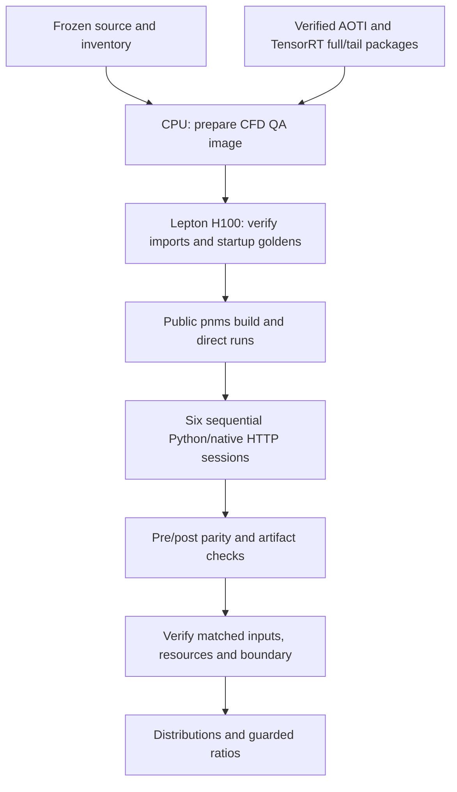

# CFD applications and matched benchmarking

The existing Python `physicsnemo-cfd-surface-benchmark` workflow and native
`physicsnemo-cfd-transolver-native` workflow serve the pinned DrivAerML `run_1`
surface case. The native application uses AOTI or TensorRT, FP32, provider math
and the H100 target in its release profile. It processes all 8,828,095 cells as
147 blocks of 60,000 and one tail of 8,095.

## Build and run an imported native application

The specialized adapter accepts a locally materialized schema-one deployment
JSON through `NATIVE_DEPLOYMENT_CONFIG`. This must include verified full/tail
model packages, statistics, independent startup golden tensors and original
compilation sources, matching the selected backend and target. `pnms build`
compiles the current C++ workflow and bundles those model bytes without
recompiling the model. Fresh checkpoint export remains a separate Model Builder
operation.

On a compatible Linux GPU node with the selected Python environment, C++/CUDA
toolchain and installed SDK:

```sh
SDK_ROOT=/path/to/installed/sdk
export NATIVE_DEPLOYMENT_CONFIG=/path/to/aoti/deployment.json
./pnms check plugins/physicsnemo-cfd-transolver-native/release.yaml
./pnms build plugins/physicsnemo-cfd-transolver-native/release.yaml --sdk-prefix "$SDK_ROOT"
printf '%s\n' '{"case_id":"run_1","seed":42,"capture_inputs":false}' > request.json
./pnms run plugins/physicsnemo-cfd-transolver-native/release.yaml \
  --input request.json \
  --input-file mesh=/path/to/run_1/boundary_1.vtp \
  --input-file geometry=/path/to/run_1/drivaer_1.stl
./pnms serve plugins/physicsnemo-cfd-transolver-native/release.yaml --dev
```

For TensorRT, select `release-tensorrt.yaml`, its deployment and an SDK containing
the required exact TensorRT plugins. An incompatible target, changed package or
failed startup golden prevents readiness. Local compilation, inference and
development serving require no Docker or Lepton installation.

The receipt exposes complete model packages for direct C++ SDK use. The sealed
bundle also contains the dedicated Runner, statistics and startup fixtures. The
native worker calls that Runner with two resident model sessions; it does not
construct another generic WorkflowHost or duplicate those sessions.

Release-image assembly requires Docker and a compatible immutable runtime base
selected in the application's `serve.image` configuration:

```sh
./pnms build --from-build /path/to/.pnms/builds/BUILD_ID/build.json \
  --image REGISTRY/APP:TAG --push
```

The image contains the sealed models and workflow under
`/opt/physicsnemo-release`, without manual artifact copying. Model compilation
provenance remains distinct from the serving source revision. See the
[application CLI](../application-cli/README.md) for runtime-image selection and
image launch commands.

## Comparable end-to-end measurements

`qa/scripts/benchmark_pnms_cfd.py` measures HTTP submission through terminal result
polling, required downloads, canonical scientific report construction and output
hashing. Native fields use the unchanged shared evaluator. Python reports and
registered audit artifacts are downloaded and verified. Both paths must produce
the same complete canonical report.

One finite Lepton job uses public `pnms` commands and runs six sessions:

```text
Python → AOTI → TensorRT → TensorRT → AOTI → Python
```

Each session measures cold service startup separately, then runs an untimed
prerequisite request, four measured requests (first and three warm requests),
and an untimed postrun request. Ratios require pre/post parity, verified saved
artifacts, exact session order, the same observed GPU and CPU/cgroup resources,
model/input identities, provider, numerical environment and math settings.
Native workers must load LibTorch bytes matching the selected Python
distribution. Failed or incomplete gates prevent comparison success.



These measurements include the current Python worker's model-loading lifecycle;
it may create a provider subprocess per request. They do not establish
kernel-only speedup, production tail latency, peak GPU memory or portability to
another GPU. Filesystem caches and GPU clocks are not reset. Correctness tensor
capture is disabled during measured requests.

## Repository acceptance

`qa/native_inference/Dockerfile.pnms-cfd` extends a freshly source-bound development
image. It carries pinned compiled imports, verifies their inventories, preserves
the numerical stack while adding Python workflow dependencies, and builds the
current exact-plugin SDK. Imported models retain their original compilation
provenance.

`scripts/run_lepton_pnms_cfd_qa.py --help` describes the finite-job controller.
It requires an immutable image, exact source and inventory hashes, and mounted
verified reference/input data. All 16 gates and transported comparison/session
identities must pass; the controller removes its owned job. Individual image-local
sessions and comparisons use `qa/scripts/benchmark_pnms_cfd.py --help`.

`scripts/run_lepton_pnms_cfd_image_qa.py` separately qualifies a sealed release
image by digest: installed source/bundle, startup goldens, repeated full
requests, scientific parity, artifact isolation and resident-worker identity.
Image construction alone does not establish acceptance or benchmark success.

Local and Windows checks cover CPU contracts. GPU and live HTTP acceptance use
Lepton on the configured H100 host. Lepton remains repository QA infrastructure.
