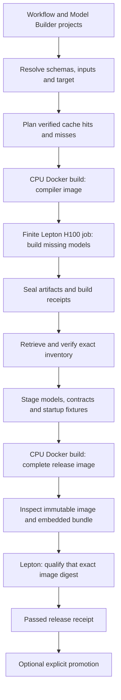

# Native workflow authoring and sealed releases

This layer connects native workflow projects to the resident worker described in
the [serving integration guide](native-worker-serving-integration.md). One
deployment selects one workflow and one compiled backend, AOTI or TensorRT.
Python plugins keep their existing authoring and serving commands.

Project generation and static validation require ordinary Python dependencies;
they do not initialize CUDA or require Docker or Lepton. The automatic release
controller below is the Linux CI/build-host integration: Docker builds images,
and finite Lepton jobs compile and qualify GPU artifacts. Its administrative
requirements are separate from the runtime image. The unified local application
CLI is a subsequent layer; it is not introduced by this change. Existing
`pnms-model-builder` commands remain available and unchanged.

## Create a project

From a repository checkout:

```sh
uv sync --frozen
uv run python scripts/plugin_dev.py init plugins/my-native \
  --runtime cpp --template tensor --backend aoti
uv run python scripts/plugin_dev.py validate plugins/my-native
```

Set `output.repository` in `plugins/my-native/release.yaml` to your image
registry/repository, without a tag or digest, before planning or building a
release. For example:

```yaml
output:
  repository: registry.example/team/my-native
```

Then inspect the release plan:

```sh
uv run python scripts/plugin_dev.py release plugins/my-native --plan
```

Select `--backend tensorrt` for TensorRT, or `--template cpp` for a source-linked
C++ adapter. `--content-type multipart/form-data` generates an HTTP upload
contract. A matched immutable stack can be selected with
`--native-image REGISTRY/REPOSITORY@sha256:DIGEST`.

The generated project contains:

```text
plugin.yaml                 HTTP workflow metadata and native pipeline
release.yaml                models, backend, target, startup and release policy
schemas/                    request and response JSON schemas
examples/                   default HTTP request
fixtures/                   startup and acceptance cases with independent goldens
model/                      Model Builder project, Python model adapter and checkpoint
native/workflow.cpp          custom C++ adapter, for --template cpp
native/CMakeLists.txt        custom target, for --template cpp
```

Replace the example affine model and its checkpoint, then update schemas,
independent startup fixtures, and qualification cases together.
Validation does not import the model or execute a Python inference hook.

For `tensor.v1`, the release declares model aliases, tensor names, shapes and
request/response codecs. For `custom.v1`, the generated `Workflow::run` receives
canonical parameters and calls `context.infer("primary", {input})`. Copy tensor
outputs into owned values before the inference result is destroyed. Domain
preprocessing and postprocessing belong in this C++ adapter.

Startup cases are distinct from model export examples. They execute the authored
workflow and use the same request, response and artifact validation as serving.
Qualification cases declare the complete required inventory. Raw FP32 and
multipart fixtures include byte sizes and hashes; unexpected paths, links,
changed files and duplicate JSON/YAML keys are rejected.

## Release transaction



On the configured Linux build/control host, install the controller dependencies,
authenticate Docker to the destination registry, and configure the existing
Lepton workspace, node group, pull secret and shared-storage location. These are
CI execution settings; credentials are supplied by the environment rather than
embedded in the workflow project or release bundle.
Cache publication on this control host uses POSIX file locks; it is not a native
Windows construction path.

```sh
python scripts/plugin_dev.py check-env plugins/my-native
python scripts/plugin_dev.py release plugins/my-native \
  --workspace /tmp/my-native-release \
  --cache-dir /var/cache/physicsnemo-native
```

The controller owns model compilation, sealed artifact handoff, image assembly
and exact-image qualification. Users of that controller do not copy compiled
packages between stages. No nested Docker is used: the CPU host runs Docker;
the GPU job runs the installed Model Builder directly inside its container.

`release --plan` reports decisions without starting a build or GPU job. Restored
cache entries are candidates: completion evidence and every declared file are
revalidated before reuse. A failed or uncertain stage produces no passed release
receipt and cannot promote an image. `check` uses the same qualification path
without promotion. The release workflow keeps evidence even when a stage fails.

## Compatibility and reuse

The compilation identity includes the model source and assets, selected backend,
export/toolchain inputs, immutable builder image, and compilation target.
The initial target is Linux amd64, H100 sm90, FP32, with MIG disabled. Changing
GPU product changes the identity even if compute capability is the same.
Deployment also checks driver bounds and available memory.

Model and workflow identities are separate. An API or Rust change can reuse a
verified model when its compilation inputs are unchanged; it still requires a
new serving image and qualification. Every alias retains the source that
originally compiled its package. The current serving source does not overwrite
that provenance. A cache hit is not deployment qualification.

## Image contents and runtime

The staged bundle is installed at `/opt/physicsnemo-release`:

```text
deployment.json             selected workflow, target and model paths
worker_runtime_config.json  existing scheduler/results roles and native settings
release-inventory.json      exact file inventory and bundle identity
model/<alias>/              verified compiled model packages and evidence
plugin/<workflow>/          HTTP plugin contract
qualification/              authored acceptance fixtures
startup/                    sealed startup input files, when declared
inputs/                     immutable release inputs, when declared
```

The custom C++ source is compiled into the installed workflow host under
`/opt/physicsnemo-workflow/lib`; serving loads that library through the CXX bridge.
The final image includes the native worker, API and worker-runtime binaries and
all selected compiled models. A request does not run a compiler or start a
separate C++ inference process.

The entrypoint uses PR3's registration gate before starting the unchanged
scheduler. Model hashes, device policy and startup cases must pass before the
worker becomes available. Readiness checks the live owner, configuration and
runtime identity. Same-slot worker recovery preserves Redis, API, scheduler and
artifact storage; whole-container or Redis loss is outside that contract.

## Validation scope

Windows checks cover portable scaffolding, static planning, artifact contracts,
and supported SDK components. Container startup, GPU compilation, image serving,
and process-fault acceptance run on Linux through Lepton. Local unit tests do not
stand in for those acceptance gates.

The full CFD workflow has AOTI and TensorRT release profiles in
`plugins/physicsnemo-cfd-transolver-native`. Its full/tail packages and scientific
reference are qualified separately from the small generated affine examples.
Historical receipts keep their original source and image attribution. New
release qualification always binds to the selected immutable image.
