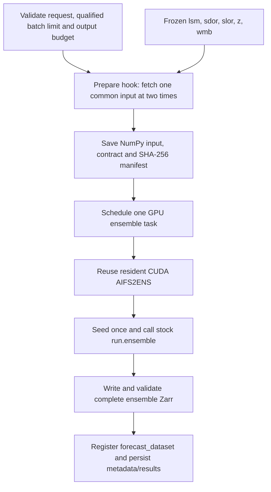

# AIFS2ENS initial single-GPU plugin

The initial `earth2-aifs2ens` plugin follows the existing single-GPU
`earth2-ensemble` pattern: one request schedules one GPU task that runs the
complete ensemble through stock `earth2studio.run.ensemble()`. A shared RNG
stream determines ensemble diversity. A separate future fan-out version will be
compared against this single-GPU baseline.

This replaces the earlier per-member task design. The current `earth2-gpu`
release, source `4b91b64806d9`, passed **412 selected tests: 405 portable and all
seven H100 cases**, with zero skips. Eight candidate rollouts passed 7,440
member/step/field comparisons. Separate full A, serial B and repeated A
forecasts through the private Lepton HTTPS endpoint passed 2,880 comparisons;
one cached GPU worker served all three, with one task and release per request
and no fan-out. Eight downloaded `t2m` field hashes also matched.

The release includes the asset-warmup, batch-admission and PR-readiness changes,
plus a QA-only wait for structured result finalization on the same accepted
run ID. Its nine stock Earth2Studio references retain their earlier image
`b58eeaf61c78` / source `53da50741e74` provenance and were reused after runtime
and scientific-source identity checks, 30 array-hash checks and 5,280 holdout
comparisons. No limits were recalibrated. Parity holds within measured native
CUDA variability for the tested fixture and layouts; bitwise equality is not
established. The [parity record](aifs2ens-parity-and-reference-workflows.md)
preserves the current evidence and historical passes/failures separately.

## Upstream contract

Use Earth2Studio commit `f8af4030cfd43ec79bf4c0cf6c23463a87bfef97`, Anemoi Models
0.11.2 and checkpoint repository revision
`29a1f8c4ab76cd0e5b64cfd415f4ff9e08edf7cf`. The loaded
`aifs-ens-crps-2.0.ckpt` defines the actual variable/grid contract. The qualified
frozen-invariant interface has 112 inputs and 120 output fields, with two input
times at −6 and 0 hours and a 721 × 1440 latitude/longitude grid. Each prediction
advances six hours.

Earth2Studio wraps the pretrained ECMWF/Anemoi network. It loads the checkpoint,
interpolates inputs to the native model grid, adds geographic/time/solar
forcings, calls the BF16 prediction path, advances the state, and regrids outputs.
AIFS2ENS generates stochastic noise inside that prediction path. The plugin
uses `Zero()` for external initial-condition perturbation and preserves the
native CUDA network and sparse noise projector.

## Request and seed semantics

```json
{
  "start_time": "2026-11-04T12:00:00Z",
  "nsteps": 4,
  "nensemble": 2,
  "batch_size": 2,
  "seed_base": 0,
  "ifs_member_id": 1,
  "output_variables": ["t2m", "msl", "u10m", "v10m"]
}
```

The example date must be replaced when its source cycle is unavailable.
`ifs_member_id` is one optional common IFS ENS input source for the entire
stochastic ensemble; omission selects `IFS`. It is distinct from the zero-based
output ensemble index. The prepare hook stages one common input, then upstream
`run.ensemble()` repeats it into the requested ensemble mini-batches.

The request accepts `nensemble` from 1–16 and `nsteps` from 1–60. `batch_size`
defaults to the complete ensemble and is clamped to `nensemble` when larger,
matching upstream. Batching stays on the same GPU. It affects peak memory and
RNG consumption; qualification covers the exact layout used by a request.

The current source enforces positive deployment setting
`AIFS2ENS_MAX_BATCH_SIZE`, default `2`, after that upstream normalization.
Preparation rejects larger effective batches before downloading; execution
rechecks staged requests before GPU work. It never silently changes the layout
to fit this limit. Larger ensembles can use explicit batches of 1 or 2. Raising
the limit requires new GPU-memory and parity qualification and a matching
`AIFS2ENS_GPU_MEMORY_MB` reservation.

The worker sets `torch.manual_seed(seed_base)` once, with `model.seed=None`,
inside `torch.random.fork_rng` for the selected GPU. The stream advances through
all steps of one mini-batch, then subsequent mini-batches in upstream order.
There is no member-specific seed schedule. CPU/CUDA RNG state and the previous
model seed are restored when the request ends. The public result records
`seed_base`, `batch_size`, `rng_policy="torch-seed-once-native-v1"` and
`numerical_policy="earth2studio-native-v1"`.

`initial_condition_mode`, `ifs_member_ids` and `max_in_flight` belong to the
superseded fan-out design and are absent from this initial request contract.

## Execution path



Preparation uses the standard CPU service hook and does not introduce a CPU
execute worker. The service requests one GPU for the whole ensemble and disables
automatic cross-request batching. It routes through the existing `earth2-gpu`
executor class, retaining the `aifs2ens` capability tag and configured GPU-memory
reservation. There are no fan-out items, child runs or
postprocess member merges. The model instance is cached per worker process and
bound to its device; a lock serializes rollouts that share that model.

Model loading verifies the checkpoint, pinned runtime and interpolation hashes
before construction. Asset preparation runs once per cached initialization;
later cached warmups do not repeat it.

The prepare hook verifies the deployment and estimated output budget before
downloading. It fetches unchanged Earth2Studio `IFS` or `IFS_ENS` fields and
adds the five frozen invariant inputs under `preload_invariants=False`.
`input-contract.json` binds coordinates, variables and checkpoint/interpolation/
invariant hashes. The manifest binds that contract, common input and normalized
request. Worker execution verifies the same bytes before inference.

`run.ensemble()` receives the common frozen datasource, `Zero()`, request batch
size and selected output coordinates. The model still computes every field
needed for its autoregressive state. The output sink filters lead zero and
stores +6h through +6×`nsteps` hours. Both shared Zarr backends are supported.
The completed dataset contains one named float32 array per requested field,
with dimensions `(ensemble, time, lead_time, lat, lon)` and shape
`(nensemble, 1, nsteps, 721, 1440)` for the qualified grid. Metadata records the
common source, complete request and artifact identities. Failed or cancelled
execution never registers a complete successful artifact.

## Qualification and deployment

The independent reference imports Earth2Studio directly and executes a complete
single-GPU ensemble with the same checkpoint, common input, invariant bytes,
seed, batch size, forecast length, output selection and native runtime settings.
It does not import the plugin's preparation or rollout helpers. Compare every
member/field/forecast step, rather than comparing independently seeded member
trajectories. The [parity plan](aifs2ens-parity-and-reference-workflows.md) and
[H100 guide](../../qa/plugins/earth2-aifs2ens/README.md) define the reference gate,
service/storage coverage, source binding and reporting requirements.

Configure `python_runtime_envs["earth2-gpu"]` in the AIFS-enabled deployment with
the plugin's pinned interpreter, artifact environment and
`launch.tags: [earth2, aifs2ens, gpu]`. The generic Earth2Studio 0.13 image does
not support this model; reusing the class leaves that dependency requirement
in place. Workers already warmed for a different workflow remain ineligible for
this task. `AIFS2ENS_GPU_MEMORY_MB` reserves resources
for the complete task and qualified batch size; request count limits alone do
not establish that every possible batch fits a GPU. The prepare timeout remains
7200 seconds for cold downloads. Static GPU launch profiles keep dry-run plan
generation from invoking the side-effectful prepare hook. All real CUDA tests
run on the configured remote H100.

The Dockerfile's default `release` stage exposes port 8001 and starts the
`serve.py` supervisor. It requires writable `AIFS2ENS_SERVICE_ROOT` and the
artifact environment, verifies the image source inventory, creates a new
session for logs and observation snapshots, and allows 600 seconds for worker
warmup or recovery. Readiness is written atomically and owned process groups
are cleaned up on exit. The deployed endpoint uses private workspace-token
authentication. Actual HTTPS forecast submissions, status/results retrieval
and a downloaded Zarr field subset were validated in the current release.
The deployed `/readyz` gate passed a direct 200→503→200 test with liveness
remaining 200. Use HTTP readiness where the orchestrator supports it; Lepton's
current API provides TCP liveness and readiness approval, without a native HTTP
readiness probe. The qualified image fingerprint binds its source snapshot;
later documentation-only edits are outside that inventory.

The initial output contract is Earth2Studio raw model fields. Independent ECMWF/
Anemoi preparation, decoded wave directions, accumulated products, additional
dates, a 60-step forecast and operational GRIB equivalence require separate
qualification. Future distributed fan-out will preserve this verified single-GPU
baseline's input, RNG draw/member mapping, batching and output semantics.

## Sources

- [Pinned AIFS2ENS wrapper](https://github.com/NVIDIA/earth2studio/blob/f8af4030cfd43ec79bf4c0cf6c23463a87bfef97/earth2studio/models/px/aifs2ens.py)
- [Pinned ensemble workflow](https://github.com/NVIDIA/earth2studio/blob/f8af4030cfd43ec79bf4c0cf6c23463a87bfef97/earth2studio/run.py)
- [Pinned IFS datasource](https://github.com/NVIDIA/earth2studio/blob/f8af4030cfd43ec79bf4c0cf6c23463a87bfef97/earth2studio/data/ecmwf.py)
- [ECMWF model card](https://huggingface.co/ecmwf/aifs-ens-2.0)
