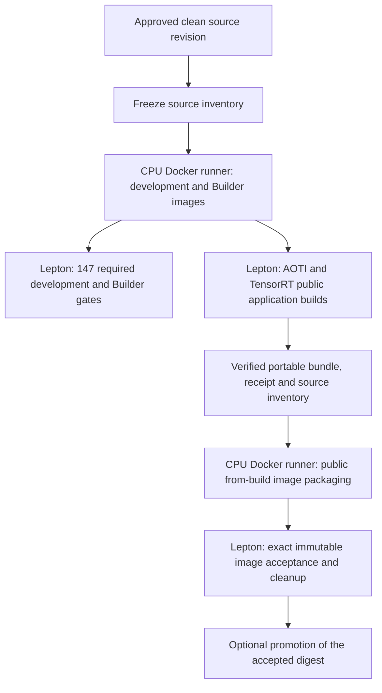

# Unified application QA

The public [`pnms` CLI](../../application-cli/README.md) runs on the user's own
machine. Lepton is used by repository acceptance QA, not by the user's local
application workflow. CPU unit/component checks may run locally or on Windows;
GPU and service acceptance run as finite Lepton jobs.

## Source-bound development profiles

Capture a clean revision with `scripts/prepare_pnms_qa_context.py`. Its archive,
inventory, file modes and hashes travel together. Build `Dockerfile.pnms` on a
Linux Docker host with an explicit compatible immutable SDK/toolchain base.
The image replaces inherited source and QA helpers with the captured revision.
Do not qualify a new checkout by reusing an older development image's source.

The reusable or manually dispatched `lepton_pnms_qa.yml` workflow consumes that
development image, the shipped `default-builder` image digest, and the same full
source SHA. It runs these mandatory profiles:

| Profile | Controller | Required cases |
| --- | --- | ---: |
| Stage source and pinned requirements | `run_lepton_pnms_stage_qa.py` | 1 |
| Shipped Builder: installed payload, both backends and SDK parity | `run_lepton_model_builder_image_qa.py` | 15 |
| Fresh venv: AOTI tensor and TensorRT custom builds | `run_lepton_pnms_venv_qa.py` | 18 |
| HTTP on those exact venv builds and interpreter | `run_lepton_pnms_http_qa.py --mode host` | 17 |
| Public Python and five native local workflows | `run_lepton_pnms_qa.py` | 47 |
| HTTP on the same local bundles, including Python | `run_lepton_pnms_http_qa.py --mode host --include-python` | 49 |

The profiles cover new and existing Python plugins; both native backends with
tensor/custom workflows; raw multipart input; independent held-out requests;
model/workflow cache reuse; relocation; environment drift and lock refresh;
readiness, invalid requests, overlap, worker recovery and owned cleanup.
The 147-case workflow must pass without changing its required case inventory.
The Builder profile runs the ordinary shipped container directly on Lepton and
compares its installed code with the staged source inventory. It does not launch
a nested Docker daemon or replace the host Docker-launcher E2E test.

Configure the existing CI workspace, node group, pull-secret name and shared
storage settings through CI secrets/variables. Both image digests and the source
SHA are explicit workflow inputs. The pinned controller version is
`leptonai==0.27.2`. The optional venv wheelhouse is an installation input, not a
substitute for source or package identity checks.

## Image packaging acceptance

Image qualification is separate from the 147-case profile workflow. Use the
carried QA-only `run_lepton_pnms_release_build.py` controller to execute a public
build and retrieve a compact verified handoff after the GPU job is removed.
On a CPU Docker host, package it through the public command:

```bash
pnms build --from-build /shared/build/build.json --image REGISTRY/APP:TAG --push
```

Verify the source inventory and unchanged compiled package before packaging.
Then use `run_lepton_pnms_http_qa.py --mode image` with the resulting immutable
digest. The `tensor-files-aoti` and `tensor-files-tensorrt` projects provide three
independent raw-upload fixtures and byte-exact output goldens. Each backend has
three build/export gates and sixteen image HTTP/fault gates. Actual Python-image
qualification uses `Dockerfile.pnms-python-base` built from the current
development image, public `pnms build --image`, and the nine-case Python image
HTTP profile. These 47 gates are run separately from the profile workflow.
Qualify custom workflow images explicitly when reporting that coverage.

Record the exact application, bundle, model compilation source, SDK/library,
source, image and fixture identities. A cached compiled model retains its
original compilation provenance. Image construction is not itself a GPU or
HTTP qualification result. Preserve original failed attempts separately from
later passing runs, and verify every required result and owned cleanup receipt.

No nested Docker is required: GPU jobs run model compilation and inference in
ordinary containers, while image assembly uses a Linux Docker host. The real
host Docker-launcher E2E test remains explicitly waived; its command/path
contracts are covered by component tests. That waiver does not replace the
ordinary-container, fresh-venv or immutable release-image acceptance profiles.

## Automatic native release qualification

`lepton_pnms_native_ci.yml` captures one clean source inventory and builds both
the development QA image and the shipped `default-builder` image on a CPU Docker
runner. It passes their immutable digests to the reusable profile workflow. A
separate AOTI/TensorRT matrix calls `lepton_pnms_release.yml` with the corresponding
`tensor-files` project and the matched development image as its runtime base.

The automatic trigger follows NVIDIA's existing approval boundary: pushes to
`main` or `pull-request/<number>` mirror branches. PR commits enter that mirror
through the repository's approval process; direct `pull_request` events do not
start this credential-bearing workflow. Relevant native application, serving,
QA, controller and workflow changes trigger the gate. Missing required
configuration fails preparation rather than skipping acceptance.

Configure these repository variables before enabling the automatic gate:

| Variable | Purpose |
| --- | --- |
| `PNMS_QA_BASE_IMAGE` | Immutable compatible native toolchain image digest |
| `PNMS_QA_REPOSITORY` | Registry/repository for temporary QA and release tags |
| `NGC_REGISTRY` | Destination registry hostname |
| `NFS_MOUNT_BASE` | Shared storage mount used by finite Lepton jobs |

The jobs use the existing `NGC_REGISTRY_PASSWORD`, `LEPTON_WORKSPACE_TOKEN`,
`LEPTON_WORKSPACE_ID`, `LEPTON_NODE_GROUP` and `PULL_SECRET` secrets. Optional
workspace URL, storage, QA directory and venv wheelhouse settings retain the
reusable workflow's defaults.

The release workflow can also be called or dispatched explicitly with a build
image digest, exact source SHA, backend, template or source-relative project,
destination repository, and matching runtime image digest. Its GPU producer
compiles through public `pnms`, then exports a verified portable build receipt,
bundle and frozen source inventory. `run_pnms_release.py` verifies this handoff,
captures only inventoried packaging source, packages through public
`pnms build --from-build`, and qualifies the published immutable digest through
Lepton HTTP acceptance. An optional promotion tag is assigned to that same
digest only after acceptance and owned-job cleanup pass. Evidence is preserved
on failure as well as success.



The automatic release matrix covers native tensor applications. Python service
images require their separately matched Python runtime base and explicit Python
image qualification; the native matrix does not imply that coverage. These
controllers remain repository QA tools and introduce no Lepton dependency into
the user's `pnms` commands or standalone `pnms-model-builder` workflow.
